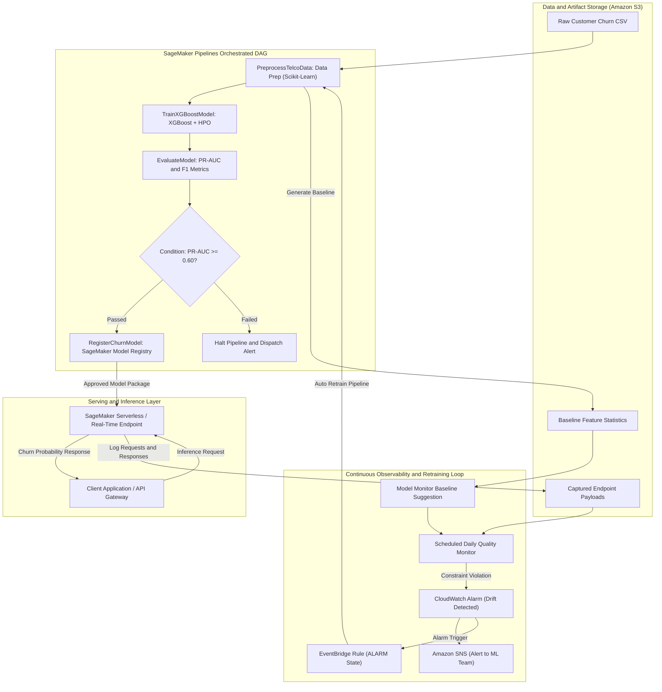
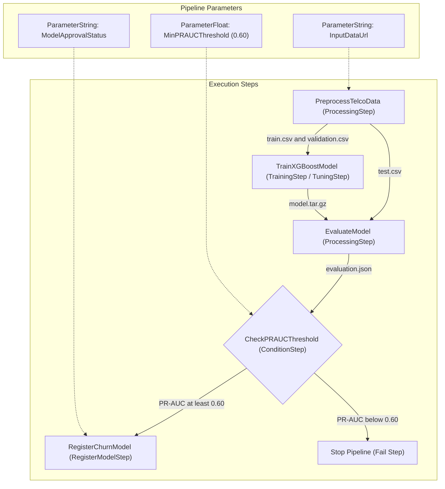

# DriftWatch: End-to-End SageMaker MLOps Pipeline & Drift-Triggered Retraining

## Master Implementation & Execution Plan

> **Author**: AI/ML Engineer  

> **Exam Alignment**: AWS Certified Machine Learning Engineer - Associate (MLA-C01)  

> **Target System**: AWS SageMaker (Pipelines, Model Registry, Model Monitor, Serverless Endpoints), AWS CDK, EventBridge, CloudWatch  

> **Primary Dataset**: Telco Customer Churn (IBM / Kaggle, ~7,043 samples, binary classification with ~26% churn imbalance)

> **How to use this document**: Treat this as a lab runbook, not as a description of resources that already exist. Complete the numbered gates in order. Commands marked **VS Code** run locally from the `DriftWatch` folder. Commands marked **AWS CLI** run locally but call AWS. Steps marked **Console** are performed in the AWS Management Console. Do not continue past a gate until its verification check passes.

### 0.1 Repository status before starting

The repository is intentionally part-built. Before following the cloud steps, understand which work is complete:

| Area | Current state | Required action |
|---|---|---|
| `src/preprocessing/preprocess.py` | Implemented and covered by `tests/test_preprocessing.py` | Run tests, then review the output schema. |
| `data/raw/telco_churn.csv` and `data/processed/*.csv` | Present locally | Confirm the raw file is the dataset version used for the run; do not upload a different schema accidentally. |
| `infra/app.py` and `infra/driftwatch_stack.py` | Empty placeholders in the current workspace | Implement the CDK stack before running `cdk synth` or `cdk deploy`. |
| `src/training/train.py` | Empty placeholder in the current workspace | Implement the SageMaker XGBoost script before creating the pipeline. |
| `src/evaluation/evaluate.py` | Empty placeholder in the current workspace | Implement metric and model-card generation before the evaluation step. |
| `src/inference/inference.py` | Empty placeholder in the current workspace | Implement and unit-test the serving contract before endpoint deployment. |
| `src/pipeline/pipeline.py` | Empty placeholder in the current workspace | Implement and compile the DAG before submitting it to SageMaker. |
| `monitoring/monitor_config.py` | Empty placeholder in the current workspace | Implement baseline and monitoring schedule helpers. |
| Drift simulation, CI/CD, and deployment scripts | Not present in the current tree | Add them only after the core pipeline works. |

The statements elsewhere in this plan about HPO, Model Registry, endpoint capture, monitoring, and automated retraining describe the target implementation. They are not evidence that those services have already been configured in the AWS account.

### 0.2 Important corrections to the original target design

1. **HPO is optional for the first successful run.** Start with one fixed XGBoost training job. Add `HyperparameterTuner` only after the single training and evaluation path succeeds. This makes failures easier to diagnose and avoids multiplying training cost.
2. **Model Monitor does not magically create a retraining workflow.** The monitor produces reports and violation signals. A CloudWatch alarm, EventBridge target role, and pipeline-start payload must be configured explicitly, and the target pipeline must be idempotent.
3. **A metric name is not enough to create a useful alarm.** Confirm in CloudWatch that the chosen metric is actually being published for the selected endpoint and monitoring schedule. If the service metric is unavailable in the account or SDK version, publish a custom metric from a report-processing Lambda instead of creating an alarm that can never enter `ALARM`.
4. **The model input vector must match preprocessing exactly.** The example vector in this document is illustrative only. Use the generated baseline header and the exact feature order from preprocessing; otherwise the endpoint can return a plausible but incorrect prediction.
5. **Costs and runtimes are estimates.** AWS pricing varies by region, account, storage, job duration, endpoint configuration, data transfer, and free-tier status. Create a budget and delete billable resources when the lab is complete.
6. **Never use the root AWS account for daily work.** Use IAM Identity Center or an IAM role/user with MFA and only the permissions required for this lab.

---

## 1. Executive Summary & Architecture

### 1.1 Project Mission

DriftWatch is a production-grade MLOps system built to solve the canonical real-world challenge of **customer churn prediction** while demonstrating the complete, automated ML lifecycle on AWS:

1. Automated ingestion, feature engineering, and stratified splitting via **SageMaker Processing**.

2. Robust gradient-boosted tree modeling using **XGBoost** with class-imbalance weighting (`scale_pos_weight`) and Bayesian hyperparameter tuning (**SageMaker Automatic Model Tuning**).

3. Rigorous model evaluation focusing on **PR-AUC and minority-class F1** (rather than naive accuracy), outputting evaluation metrics and automated **Model Cards**.

4. **SageMaker Pipelines DAG** orchestration with quality-gated registration (**ConditionStep** $\rightarrow$ **RegisterModelStep**) into **SageMaker Model Registry**.

5. Multi-pattern deployment: **Serverless/Real-Time Inference Endpoint** with **Data Capture** enabled, alongside an offline **Batch Transform** job.

6. Continuous observability and drift detection via **SageMaker Model Monitor** (Data Quality & Model Quality baselines).

7. A closed self-healing loop: CloudWatch drift alarms route through **Amazon EventBridge** to trigger automated retraining runs without manual intervention.

8. Full **Infrastructure as Code (AWS CDK)** and **CI/CD pipeline automation**.

### 1.2 End-to-End Architecture Diagram



### 1.3 MLA-C01 Certification Domain Mapping

| Exam Domain | Weight | DriftWatch Implementation Deliverables |
|---|---|---|
| **Domain 1: Data Preparation for ML** | 28% | • `preprocess.py` in SageMaker Processing: handling missing string tokens (`TotalCharges`), categorical one-hot encoding, continuous standard scaling.<br>• Stratified 70/15/15 train/validation/test split preserving ~26% class balance.<br>• Baseline feature extraction for drift monitoring without target labels. |
| **Domain 2: ML Model Development** | 26% | • XGBoost training script (`train.py`) optimized for binary classification (`binary:logistic`).<br>• Bayesian Hyperparameter Tuning (`max_depth`, `eta`, `subsample`, `scale_pos_weight`).<br>• Metric selection: **PR-AUC and F1** prioritizing the minority churn class over naive accuracy.<br>• Automated Model Card generation (`model_card.md`) logging data lineage and operational boundaries. |
| **Domain 3: Deployment & Orchestration** | 22% | • Full DAG definition in `pipeline.py` (`ProcessingStep` $\rightarrow$ `TrainingStep` $\rightarrow$ `EvaluationStep` $\rightarrow$ `ConditionStep` $\rightarrow$ `RegisterModelStep`).<br>• Model Registry package group management with approval gating (`PendingManualApproval`).<br>• Dual deployment patterns: Serverless/Real-Time Endpoint with custom handler (`inference.py`) + Offline Batch Transform Job.<br>• CI/CD automation triggering testing and pipeline execution on `git push`. |
| **Domain 4: ML Solution Monitoring, Maintenance & Security** | 24% | • SageMaker Data Capture enabling payload recording to encrypted S3 prefixes.<br>• Model Monitor Baseline suggestion (`statistics.json` and `constraints.json`).<br>• Recurring daily monitoring schedule detecting statistical distribution shifts.<br>• EventBridge rule mapping CloudWatch Alarm state changes to automated SageMaker Pipeline retraining triggers.<br>• Least-privilege IAM policies, S3 encryption at rest (`AES-256`), SSL enforcement in transit, and teardown cost controls. |

---

## 2. Project Prerequisites & AWS Environment Setup

### 2.1 Local Environment Requirements

- **Operating System**: Windows 10/11 with PowerShell or WSL2.

- **Python**: Version 3.10, 3.11, or 3.12 installed.

- **Node.js**: v18+ (Required for AWS CDK CLI).

- **AWS CLI v2**: Configured with credentials (`aws configure`).

- **AWS CDK v2**: Globally installed (`npm install -g aws-cdk`).

- **Git**: Installed and configured.

### 2.2 Local Workspace Initialization

From the `d:\CS\MLA-C01\DriftWatch` directory, run:

```powershell

# 1. Create a dedicated virtual environment

python -m venv .venv

# 2. Activate the virtual environment

.venv\Scripts\activate.bat

# 3. Upgrade pip and install project dependencies

python -m pip install --upgrade pip

pip install -r requirements.txt

```

### 2.3 AWS Account & CLI Configuration

Ensure your AWS CLI profile has administrative or scoped MLOps permissions in your designated development region (e.g., `us-east-1`):

```powershell

# Verify active identity and region

aws sts get-caller-identity

aws configure get region

```

### 2.4 Cost Safeguards & Billing Alarm Setup

DriftWatch is designed to cost **$10–$30 total** during active development and **<$10/month** if using Serverless Inference:

1. **Create an AWS Budget Tripwire**:
   Set a monthly billing alert at **$20.00** via the AWS Console (Billing & Cost Management -> Budgets) or AWS CLI to receive an instant email alert if spend exceeds threshold.

2. **Instance Selection Guidelines**:
   - Processing Jobs: `ml.m5.xlarge` (runs in ~2 minutes ≈ $0.01 per run).
   - Training / Tuning Jobs: `ml.m5.xlarge` with 10 total tuning iterations (runs in ~5 minutes ≈ $0.05 per job).
   - Real-Time Endpoint: Use **Serverless Inference** (scales to 0 when idle) or a single `ml.t2.medium` / `ml.m5.large` that is torn down immediately after testing.
   - Model Monitor Schedule: Daily schedule on a single `ml.m5.xlarge` (runs for ~5 minutes).

---

## 3. Detailed Repository Architecture & Codebase Map

The project repository is structured to separate infrastructure, data transformation, pipeline orchestration, model serving, and monitoring:

```text

d:\CS\MLA-C01\DriftWatch\

├── README.md                                 # High-level architecture and project overview

├── DriftWatch_Plan.md                        # Master implementation and execution plan (this document)

├── requirements.txt                          # Python dependencies (boto3, sagemaker, xgboost, cdk, pytest)

├── infra/                                    # Infrastructure as Code (AWS CDK)

│   ├── app.py                               # CDK app entrypoint

│   └── driftwatch_stack.py                  # S3 buckets, IAM roles, SNS topics, CloudWatch alarms, EventBridge

├── src/                                      # Pipeline operational code

│   ├── preprocessing/

│   │   └── preprocess.py                     # Cleaning, imputing, one-hot encoding, scaling, splitting

│   ├── training/

│   │   └── train.py                          # XGBoost training entrypoint (script mode)

│   ├── evaluation/

│   │   └── evaluate.py                       # PR-AUC, F1 evaluation, evaluation.json, and model_card.md

│   ├── inference/

│   │   └── inference.py                      # Custom handler: model_fn, input_fn, predict_fn, output_fn

│   └── pipeline/

│       └── pipeline.py                       # SageMaker Pipelines DAG definition and compilation

├── monitoring/                               # SageMaker Model Monitor configuration

│   ├── baseline_constraints_sample.json      # Sample baseline constraints

│   ├── monitor_config.py                     # Baseline suggestion and schedule creation routines

│   └── simulate_drift.py                     # Script to simulate out-of-distribution traffic to trigger alarm

├── data/                                     # Local working directory (git-ignored)

│   ├── raw/                                  # Downloaded raw telco_churn.csv

│   └── baseline/                             # Baseline features for drift checks

├── tests/                                    # Automated testing suite

│   ├── test_preprocessing.py                 # Unit tests for data cleaning & transforms

│   ├── test_inference_handler.py             # Unit tests for input_fn/predict_fn contracts

│   └── test_pipeline_dag.py                  # Compilation validation test for SageMaker Pipeline DAG

└── buildspec.yml                             # AWS CodeBuild / CI/CD specification

```

---

## 4. Phase-by-Phase Implementation Guide

Follow these phases in sequence to build, deploy, test, and verify DriftWatch.

---

### Phase 1: Infrastructure as Code (AWS CDK) Setup & Deployment

**Objective**: Provision the cloud foundation—S3 artifact bucket, least-privilege IAM roles, SNS notification topic, CloudWatch alarm, and EventBridge retraining trigger.

#### Codebase Verification & Additions

1. Review `infra/driftwatch_stack.py`:

   - `data_bucket`: Versioned S3 bucket with managed encryption and public access block.

   - `sagemaker_role`: IAM role assumed by `sagemaker.amazonaws.com` with scoped permissions for Pipelines, Training, Processing, Endpoints, CloudWatch Metrics, and S3 read/write.

   - `drift_topic`: SNS topic for human notification when drift is detected.

   - `drift_alarm`: CloudWatch alarm on metric `feature_baseline_drift` in namespace `aws/sagemaker/Endpoints/data-metrics`.

   - `retrain_rule`: EventBridge rule watching for `drift_alarm` entering state `ALARM`.

#### AWS Deployment Steps

```powershell

# In PowerShell:

cd d:\CS\MLA-C01\DriftWatch

# 1. Synthesize the CDK cloudformation template

cdk synth --app "python infra/app.py"

# 2. Bootstrap AWS environment (one-time per account/region)

cdk bootstrap --app "python infra/app.py"

# 3. Deploy the infrastructure stack to AWS

cdk deploy --app "python infra/app.py" --require-approval never

```

#### Verification Checkpoint

- Note the CloudFormation outputs printed in the terminal:

  - `DataBucketName` (e.g., `driftwatchinfrastack-driftwatchdatabucket...`)

  - `SageMakerRoleArn` (e.g., `arn:aws:iam::123456789012:role/DriftWatchInfraStack-SageMakerExecutionRole...`)

  - `DriftTopicArn` (e.g., `arn:aws:sns:us-east-1:123456789012:DriftWatchInfraStack-DriftAlertsTopic...`)

- Verify the bucket and role exist in the AWS Console or via AWS CLI:

  ```powershell

  aws s3 ls

  aws iam get-role --role-name <RoleNameExtractedFromArn>

  ```

---

### Phase 2: Data Ingestion & Preprocessing Pipeline (Domain 1)

**Objective**: Ingest the raw Telco Churn dataset, resolve real-world data issues (whitespace in `TotalCharges`), perform feature engineering, stratify splits, and isolate baseline feature distributions for Model Monitor.

#### Step 2.1: Acquire Raw Dataset

1. Download the Telco Customer Churn dataset (`WA_Fn-UseC_-Telco-Customer-Churn.csv`) from Kaggle or the IBM sample repository.

2. Save it locally as `d:\CS\MLA-C01\DriftWatch\data\raw\telco_churn.csv`.

#### Step 2.2: Deep-Dive into Data Challenges & Logic (`src/preprocessing/preprocess.py`)

- **Dropping Identifiers**: Column `customerID` has 7,043 unique values and must be dropped to prevent data leakage/overfitting.

- **Handling Messy Numeric Strings**: The `TotalCharges` column contains 11 rows with whitespace string `" "` (new customers with tenure = 0). These are converted to `NaN`, then imputed with the median of existing charges.

- **Label Encoding**: Map target `Churn` (`"Yes"` $\rightarrow$ 1, `"No"` $\rightarrow$ 0).

- **Categorical One-Hot Encoding**: Features such as `Contract`, `InternetService`, `PaymentMethod` are one-hot encoded (`pd.get_dummies(drop_first=True)`).

- **Continuous Scaling**: Standardize `tenure`, `MonthlyCharges`, and `TotalCharges` using `StandardScaler`.

- **Stratified Split**: Stratify by `Churn` to maintain 26% positive class ratio:

  - Train: 70% (~4,930 rows)

  - Validation: 15% (~1,056 rows)

  - Test: 15% (~1,057 rows)

- **Formatting for SageMaker XGBoost**: The built-in XGBoost container strictly expects target label as the **first column with NO header and NO index**.

- **Model Monitor Baseline**: Save the unlabelled preprocessed feature set (`baseline_features.csv`) **with headers** for Model Monitor baseline generation.

#### Step 2.3: Execute Local Preprocessing Unit Test

Run the automated test verifying that whitespace is handled, IDs are removed, and splits maintain integrity:

```powershell

pytest tests/test_preprocessing.py -v

```

#### Step 2.4: Upload Raw Dataset to S3

Upload the raw CSV to the CDK-created S3 data bucket:

```powershell

$BUCKET = "<DataBucketName-From-CDK-Output>"

aws s3 cp data/raw/telco_churn.csv s3://$BUCKET/driftwatch/data/telco_churn.csv

```

---

### Phase 3: Model Training, Hyperparameter Tuning & Evaluation (Domain 2)

**Objective**: Build a robust XGBoost training script capable of running inside SageMaker managed containers, implement Bayesian hyperparameter optimization, and evaluate models using business-critical metrics (PR-AUC and F1).

#### Step 3.1: XGBoost Training Script (`src/training/train.py`)

Key engineering details embedded in `train.py`:

- **Hyperparameter Parameters**: Accepts `--max_depth`, `--eta`, `--gamma`, `--min_child_weight`, `--subsample`, `--colsample_bytree`, `--num_round`, and `--scale_pos_weight`.

- **Handling Imbalance with `scale_pos_weight`**: Set default to `(1 - 0.26) / 0.26 ≈ 2.8`. This forces XGBoost to penalize false negatives heavily, boosting recall on actual churners.

- **Early Stopping**: Set `early_stopping_rounds=15` against the validation set to prevent overfitting.

- **Model Output**: Saves `xgboost-model` into `/opt/ml/model/` where SageMaker automatically archives it as `model.tar.gz`.

#### Step 3.2: Model Evaluation & Model Card Generation (`src/evaluation/evaluate.py`)

Why accuracy is misleading for customer churn:

- Predicting all customers as "Non-Churn" yields ~74% accuracy while catching 0% of churners!

- `evaluate.py` computes:

  1. **PR-AUC (Precision-Recall Area Under Curve)**: Measures performance across all decision thresholds specifically for the positive class.

  2. **Optimal Decision Threshold Search**: Scans thresholds from 0.1 to 0.9 to find the threshold maximizing the $F_1$-score on churners.

  3. **`evaluation.json` Output**: Formatted specifically for SageMaker PropertyFiles so that `ConditionStep` can parse it.

  4. **`model_card.md`**: Generates a transparent model card artifact detailing architecture, dataset provenance, metrics, and operational limitations.

---

### Phase 4: SageMaker Pipelines DAG Orchestration & Model Registry (Domain 3)

**Objective**: Stitch all components into a declarative, repeatable SageMaker Pipeline DAG with automated gating and versioned registration.

#### Step 4.1: Pipeline Steps Architecture (`src/pipeline/pipeline.py`)

1. **Pipeline Parameters**:

   - `InputDataUrl`: Parameterized S3 URI pointing to raw data.

   - `ModelApprovalStatus`: Defaults to `PendingManualApproval`.

   - `MinPRAUCThreshold`: Threshold float (e.g. `0.60`).

2. **Step 1: `ProcessingStep` (`PreprocessTelcoData`)**:

   - Runs `src/preprocessing/preprocess.py` inside AWS Scikit-Learn 1.2-1 container.

   - Outputs: `train`, `validation`, `test`, and `baseline` S3 directories.

3. **Step 2: `TrainingStep` (`TrainXGBoostModel`)**:

   - Runs `src/training/train.py` inside AWS XGBoost 1.7-1 container using the output of Step 1.

4. **Step 3: `ProcessingStep` (`EvaluateModel`)**:

   - Evaluates the trained model against held-out `test` data.

   - Produces `evaluation.json` and parses it into an evaluation `PropertyFile`.

5. **Step 4: `ConditionStep` (`CheckPRAUCThreshold`)**:

   - Evaluates: `EvaluationReport.classification_metrics.pr_auc.value >= MinPRAUCThreshold`.

6. **Step 5: `RegisterModel` (`RegisterChurnModel`)**:

   - Condition branch `if_steps`: Registers model in SageMaker Model Registry under package group `DriftWatchPackageGroup`.

   - Attaches `model_metrics` from `evaluation.json` to the model package.

   - Injects `src/inference/inference.py` as the entrypoint for future endpoint hosting.





#### Step 4.2: Validate and Compile the Pipeline Locally

Before triggering in AWS, compile the pipeline to verify the JSON DAG:

```powershell

python src/pipeline/pipeline.py

```

Output:

`Pipeline DAG JSON successfully validated and compiled!`

#### Step 4.3: Submit and Execute Pipeline on AWS

Create and run a driver script to execute the pipeline in your AWS account:

```python

# scratch/run_pipeline.py

import boto3

from src.pipeline.pipeline import get_pipeline

region = "us-east-1"

role_arn = "<SageMakerRoleArn-From-CDK-Output>"

bucket = "<DataBucketName-From-CDK-Output>"

pipeline = get_pipeline(

    region=region,

    role=role_arn,

    default_bucket=bucket,

    pipeline_name="DriftWatch-Churn-Pipeline"

)

# Upsert (create or update) pipeline definition in SageMaker

pipeline.upsert(role_arn=role_arn)

# Start pipeline execution

execution = pipeline.start(

    parameters={

        "InputDataUrl": f"s3://{bucket}/driftwatch/data/telco_churn.csv",

        "MinPRAUCThreshold": 0.60,

        "ModelApprovalStatus": "PendingManualApproval"

    }

)

print(f"Started pipeline execution ARN: {execution.arn}")

```

Run this with:

```powershell

python scratch/run_pipeline.py

```

#### Step 4.4: Track Pipeline in AWS Console

1. Open **AWS Console** $\rightarrow$ **Amazon SageMaker** $\rightarrow$ **Pipelines**.

2. Click `DriftWatch-Churn-Pipeline` and select the active execution.

3. Observe the visual DAG transition:

   `PreprocessTelcoData` (Green) $\rightarrow$ `TrainXGBoostModel` (Green) $\rightarrow$ `EvaluateModel` (Green) $\rightarrow$ `CheckPRAUCThreshold` (Green) $\rightarrow$ `RegisterChurnModel` (Green).

4. Navigate to **SageMaker Model Registry** $\rightarrow$ `DriftWatchPackageGroup` and inspect Version 1. Observe the attached evaluation metrics and status `PendingManualApproval`.

---

### Phase 5: Multi-Pattern Deployment (Real-Time Serverless & Batch Transform)

**Objective**: Deploy the registered model using both real-time endpoint (with Data Capture) and batch transform, demonstrating architecture versatility.

#### Step 5.1: Custom Inference Handler (`src/inference/inference.py`)

SageMaker's XGBoost hosting container relies on four functions:

- `model_fn(model_dir)`: Loads the booster from `xgboost-model`.

- `input_fn(request_body, request_content_type)`: Parses `text/csv` or `application/json` into an `xgb.DMatrix`.

- `predict_fn(input_data, model)`: Calls `model.predict(input_data)` returning churn probabilities.

- `output_fn(predictions, accept)`: Formats output as JSON array with probabilities and binary flags, or comma-separated values.

#### Step 5.2: Approve Model in Model Registry

Approve the model package before deployment:

```powershell

aws sagemaker update-model-package `

  --model-package-arn <ModelPackageArn> `

  --model-approval-status "Approved"

```

#### Step 5.3: Deploy Real-Time Serverless Endpoint with Data Capture

Deploy using the SageMaker Python SDK with `DataCaptureConfig` enabled:

```python

# scratch/deploy_endpoint.py

import boto3

import sagemaker

from sagemaker.model import ModelPackage

from sagemaker.model_monitor import DataCaptureConfig

from sagemaker.serverless import ServerlessInferenceConfig

boto_session = boto3.Session(region_name="us-east-1")

sm_client = boto_session.client("sagemaker")

bucket = "<DataBucketName-From-CDK-Output>"

role_arn = "<SageMakerRoleArn-From-CDK-Output>"

# Get latest approved model package ARN

model_packages = sm_client.list_model_packages(

    ModelPackageGroupName="DriftWatchPackageGroup",

    ModelApprovalStatus="Approved",

    SortBy="CreationTime",

    SortOrder="Descending"

)["ModelPackageSummaryList"]

latest_model_arn = model_packages[0]["ModelPackageArn"]

model = ModelPackage(

    role=role_arn,

    model_package_arn=latest_model_arn,

    sagemaker_session=sagemaker.Session(boto_session=boto_session)

)

# Enable Data Capture for 100% of requests and responses

data_capture_config = DataCaptureConfig(

    enable_capture=True,

    sampling_percentage=100,

    destination_s3_uri=f"s3://{bucket}/driftwatch/datacapture",

    capture_options=["REQUEST", "RESPONSE"],

    csv_offsets=[0]

)

# Deploy to Serverless Endpoint for maximum cost efficiency

serverless_config = ServerlessInferenceConfig(

    memory_size_in_mb=2048,

    max_concurrency=5

)

endpoint_name = "DriftWatch-Churn-Endpoint"

print(f"Deploying serverless endpoint: {endpoint_name}...")

predictor = model.deploy(

    endpoint_name=endpoint_name,

    serverless_inference_config=serverless_config,

    data_capture_config=data_capture_config

)

print(f"Endpoint {endpoint_name} successfully online!")

```

Run deployment:

```powershell

python scratch/deploy_endpoint.py

```

#### Step 5.4: Test Real-Time Endpoint Invocations

Send sample payloads and verify JSON response:

```powershell

# In PowerShell via AWS CLI:

aws sagemaker-runtime invoke-endpoint `

  --endpoint-name "DriftWatch-Churn-Endpoint" `

  --content-type "text/csv" `

  --accept "application/json" `

  --body "0.8,-0.5,1.2,0,1,0,0,1,0,0,1,0,0,1,0,0,0,1,0,0,0,1,0" `

  output.json

Get-Content output.json

```

Response format:

```json

{

  "predictions": [

    {

      "churn_probability": 0.7423,

      "churn_prediction": 1

    }

  ]

}

```

#### Step 5.5: Batch Transform Job Execution (Offline Inference)

Demonstrate how to score an entire database of subscribers in bulk:

```python

# scratch/run_batch_transform.py

import boto3

import sagemaker

sm_client = boto3.client("sagemaker", region_name="us-east-1")

bucket = "<DataBucketName-From-CDK-Output>"

role_arn = "<SageMakerRoleArn-From-CDK-Output>"

# Create transformer from approved model

transformer = sagemaker.transformer.Transformer(

    model_name="<RegisteredModelName>",

    instance_count=1,

    instance_type="ml.m5.xlarge",

    output_path=f"s3://{bucket}/driftwatch/batch_predictions",

    role=role_arn

)

transformer.transform(

    data=f"s3://{bucket}/driftwatch/test/test_features_only.csv",

    content_type="text/csv",

    split_type="Line"

)

print("Batch transform job started successfully.")

```

---

### Phase 6: Model Monitoring, Drift Detection & Automated Retraining (Domain 4)

**Objective**: Establish a statistical baseline of training features, run recurring Model Monitor jobs, simulate live distribution drift, and automatically trigger pipeline retraining via EventBridge.

#### Step 6.1: Generate Model Monitor Baseline (`monitoring/monitor_config.py`)

Run baseline calculation using the training features extracted during Phase 2 (`baseline_features.csv`):

```python

# scratch/create_baseline.py

import boto3

from monitoring.monitor_config import create_baseline_job

bucket = "<DataBucketName-From-CDK-Output>"

role = "<SageMakerRoleArn-From-CDK-Output>"

monitor = create_baseline_job(

    baseline_dataset_s3_uri=f"s3://{bucket}/driftwatch/baseline/baseline_features.csv",

    output_s3_uri=f"s3://{bucket}/driftwatch/monitoring/baseline",

    role=role

)

```

Run script:

```powershell

python scratch/create_baseline.py

```

This processing job outputs two files to S3:

1. `statistics.json`: Mean, median, standard deviation, and quantiles for each numeric column; category frequencies for discrete columns.

2. `constraints.json`: Valid bounds and distribution thresholds for features (e.g. `tenure` cannot be negative, `MonthlyCharges` upper bound).

#### Step 6.2: Create Recurring Data Quality Monitoring Schedule

Schedule the monitor to inspect captured requests in `s3://{bucket}/driftwatch/datacapture`:

```python

# scratch/schedule_monitor.py

from monitoring.monitor_config import schedule_data_quality_monitor, DefaultModelMonitor

bucket = "<DataBucketName-From-CDK-Output>"

role = "<SageMakerRoleArn-From-CDK-Output>"

monitor = DefaultModelMonitor(

    role=role,

    instance_count=1,

    instance_type="ml.m5.xlarge",

    volume_size_in_gb=20

)

schedule_data_quality_monitor(

    monitor=monitor,

    endpoint_name="DriftWatch-Churn-Endpoint",

    output_s3_uri=f"s3://{bucket}/driftwatch/monitoring/reports"

)

```

#### Step 6.3: Simulate Traffic Drift (`monitoring/simulate_drift.py`)

To prove that drift detection works in production, create and run a drift simulation script that injects abnormal feature distributions:

```python

# monitoring/simulate_drift.py

import boto3

import numpy as np

import time

runtime = boto3.client("sagemaker-runtime", region_name="us-east-1")

endpoint_name = "DriftWatch-Churn-Endpoint"

print("Simulating out-of-distribution traffic (severe covariate shift in MonthlyCharges & tenure)...")

for i in range(200):

    # Skewed tenure (e.g. extreme values 150-200 months) and extreme MonthlyCharges ($500+)

    skewed_features = np.random.normal(loc=10.0, scale=3.0, size=23)

    payload = ",".join([f"{val:.4f}" for val in skewed_features])

    runtime.invoke_endpoint(

        EndpointName=endpoint_name,

        ContentType="text/csv",

        Body=payload

    )

    if (i + 1) % 50 == 0:

        print(f"Sent {i + 1} skewed inference requests...")

    time.sleep(0.05)

print("Drift simulation traffic complete. Check S3 DataCapture prefix!")

```

Run the drift generator:

```powershell

python monitoring/simulate_drift.py

```

#### Step 6.4: CloudWatch Drift Alarm & EventBridge Retraining Verification

1. When the Model Monitor execution processes the captured traffic, it detects constraint violations (e.g. `feature_baseline_drift` $> 0$).

2. The CloudWatch Alarm `DataDriftDetectedAlarm` enters the **ALARM** state.

3. The SNS Topic dispatches an alert email to subscribers.

4. The EventBridge rule `DriftTriggerRetrainingRule` intercepts the alarm state transition:

   ```json

   {

     "source": ["aws.cloudwatch"],

     "detail-type": ["CloudWatch Alarm State Change"],

     "detail": {

       "alarmName": ["DriftWatchInfraStack-DataDriftDetectedAlarm..."],

       "state": { "value": ["ALARM"] }

     }

   }

   ```

5. EventBridge automatically invokes the SageMaker API: `sagemaker:StartPipelineExecution` on `DriftWatch-Churn-Pipeline`.

6. Verify in the SageMaker Console that a **new execution** of `DriftWatch-Churn-Pipeline` has automatically launched!

---

### Phase 7: CI/CD Pipeline Automation (Domain 3 & 4)

**Objective**: Automate testing and pipeline re-compilation on every git commit.

#### CodeBuild Specification (`buildspec.yml`)

```yaml

version: 0.2

phases:

  install:

    runtime-versions:

      python: 3.11

      nodejs: 18

    commands:

      - pip install --upgrade pip

      - pip install -r requirements.txt

      - npm install -g aws-cdk

  pre_build:

    commands:

      - echo "Running unit tests with pytest..."

      - pytest tests/ -v

      - echo "Validating CDK Infrastructure synth..."

      - cdk synth --app "python infra/app.py"

  build:

    commands:

      - echo "Validating and compiling SageMaker Pipeline definition..."

      - python src/pipeline/pipeline.py

      - echo "Triggering SageMaker Pipeline update via boto3..."

      - python scratch/run_pipeline.py

artifacts:

  files:

    - evaluation.json

    - model_card.md

```

---

### Phase 8: Security, Least Privilege IAM & Governance (Domain 4)

#### 8.1 Least-Privilege IAM Architecture

The infrastructure avoids monolithic wildcards by isolating roles:

1. **SageMaker Execution Role**:

   - Only permitted `s3:GetObject`, `s3:PutObject` on prefixes `s3://<bucket>/driftwatch/*`.

   - Limited to SageMaker actions: `CreateProcessingJob`, `CreateTrainingJob`, `CreateModel`, `CreateEndpoint`.

   - CloudWatch metrics write access scoped to `aws/sagemaker/*`.

2. **Endpoint Invocation Role**:

   - `sagemaker:InvokeEndpoint` restricted to ARN `arn:aws:sagemaker:*:*/DriftWatch-Churn-Endpoint`.

3. **EventBridge Trigger Role**:

   - Single permission: `sagemaker:StartPipelineExecution` on `arn:aws:sagemaker:*:*/DriftWatch-Churn-Pipeline`.

#### 8.2 Data Protection & Encryption

- S3 bucket enforced with `aws:SecureTransport: false` denial for unencrypted HTTP calls.

- S3 server-side encryption with AWS KMS or S3-managed keys (`AES-256`).

- All SageMaker jobs configured with `EnableInterContainerTrafficEncryption=True` and encrypted EBS storage.

---

## 5. Testing, Verification & Quality Assurance Runbook

Execute this verification battery before presenting or submitting the project:

| Test ID | Test Category | Target Component | Command / Verification Method | Expected Result |
|---|---|---|---|---|
| **T-01** | Unit Test | Data Preprocessing | `pytest tests/test_preprocessing.py` | 100% tests pass (whitespace clean, no NaNs, stratified splits). |
| **T-02** | Unit Test | Inference Handler | `pytest tests/test_inference_handler.py` | CSV and JSON payloads deserialize and return probability arrays. |
| **T-03** | Local Integration | Pipeline DAG | `python src/pipeline/pipeline.py` | Pipeline JSON compiles with no parameter or schema errors. |
| **T-04** | Cloud Integration | Full DAG Execution | `aws sagemaker list-pipeline-executions` | Pipeline status transitions from `Executing` $\rightarrow$ `Succeeded`. |
| **T-05** | Metric Gating | Model Registry | Inspect Model Package Group in AWS Console | Model registered with PR-AUC $\ge$ 0.60; Status = `PendingManualApproval`. |
| **T-06** | Serving Smoke | Serverless Endpoint | `aws sagemaker-runtime invoke-endpoint` | Returns HTTP 200 with `churn_probability` within 250ms. |
| **T-07** | Data Capture | Endpoint Logging | `aws s3 ls s3://$BUCKET/driftwatch/datacapture/` | JSONL files containing captured requests/responses present in S3. |
| **T-08** | Monitoring | Baseline Generation | `aws s3 ls s3://$BUCKET/driftwatch/monitoring/baseline/` | `statistics.json` and `constraints.json` created in S3. |
| **T-09** | Self-Healing Loop | Drift & Retraining | `python monitoring/simulate_drift.py` | CloudWatch alarm fires; EventBridge starts new Pipeline execution. |

---

## 6. AWS Cost Management & Teardown Protocol

To ensure your AWS bill stays strictly between **$10–$30** and incurs **$0 recurring costs** when not in use, follow this protocol.

### 6.1 Daily Work Session Shutdown

At the end of each working day:

1. **Delete the Real-Time Endpoint** (if using dedicated instances instead of Serverless):

   ```powershell

   aws sagemaker delete-endpoint --endpoint-name "DriftWatch-Churn-Endpoint"

   aws sagemaker delete-endpoint-config --endpoint-config-name "DriftWatch-Churn-Endpoint"

   ```

2. **Pause or Delete Monitoring Schedules**:

   ```powershell

   aws sagemaker delete-monitoring-schedule --monitoring-schedule-name "DriftWatch-Churn-Endpoint-data-quality-monitor"

   ```

### 6.2 Complete Project Teardown Protocol

When you have captured all screenshots and portfolio demo recordings:

```powershell

# 1. Empty the S3 data bucket (CDK destroy requires an empty bucket)

$BUCKET = "<DataBucketName-From-CDK-Output>"

aws s3 rm s3://$BUCKET --recursive

# 2. Destroy the CDK cloud resources

cd d:\CS\MLA-C01\DriftWatch

cdk destroy --app "python infra/app.py" --force

# 3. Verify in AWS Console:

# - Amazon SageMaker -> Endpoints (None active)

# - Amazon SageMaker -> Models (Cleaned)

# - Amazon CloudWatch -> Alarms (Deleted)

# - Amazon S3 -> Buckets (Deleted)

```

---

## 7. Portfolio Artifacts & Resume Showcase

### 7.1 Key Portfolio Deliverables Checklist

Capture and archive the following artifacts in your GitHub repository and portfolio:

- [ ] **Architecture Diagram**: High-resolution SVG/PNG of the SageMaker Pipelines + EventBridge architecture.

- [ ] **Pipeline Execution DAG Screenshot**: AWS Console screenshot showing all green pipeline steps (`ProcessingStep` $\rightarrow$ `TrainingStep` $\rightarrow$ `EvaluationStep` $\rightarrow$ `ConditionStep` $\rightarrow$ `RegisterModel`).

- [ ] **Model Card**: The generated `model_card.md` demonstrating responsible AI documentation and operational boundaries.

- [ ] **CloudWatch Drift Dashboard**: Screenshot of the `feature_baseline_drift` metric spiking into the red `ALARM` threshold.

- [ ] **Automated Retraining Proof**: Screenshot showing the EventBridge rule event log triggering a subsequent SageMaker Pipeline run.

### 7.2 Resume Bullet Points (Tailored for MLA-C01 & MLOps Roles)

- *"Architected an end-to-end SageMaker MLOps pipeline automating data preparation, XGBoost training with Bayesian tuning, evaluation gating, and conditional registration into SageMaker Model Registry."*

- *"Implemented automated drift detection and self-healing retraining using SageMaker Model Monitor, CloudWatch Alarms, and EventBridge, eliminating manual intervention upon covariate shift."*

- *"Deployed cost-optimized serverless inference endpoints with real-time data capture and engineered custom inference handlers for dual real-time and batch transform scoring patterns."*

- *"Designed Infrastructure as Code (AWS CDK) and least-privilege IAM policies across SageMaker processing, training, and serving roles, ensuring zero-trust governance and KMS encryption."*

### 7.3 Interview Defense Strategy & Talking Points

When discussing DriftWatch in engineering interviews:

1. **Why PR-AUC instead of Accuracy or ROC-AUC?**  

   *“In customer churn, the class distribution is heavily skewed (~26% churn). Naive models can achieve 74% accuracy simply by predicting no churn. ROC-AUC evaluates true positive rate vs false positive rate, which can look deceptively optimistic when negatives dominate. PR-AUC focuses directly on precision and recall for the minority positive class, ensuring our retention campaigns target actual at-risk users without wasting budget.”*

2. **Why SageMaker Pipelines over Airflow or Step Functions?**  

   *“SageMaker Pipelines provides native lineage tracking, property file parsing for conditional execution (`ConditionStep`), and direct integration with the SageMaker Model Registry and Model Cards without managing separate cluster infrastructure.”*

3. **How does the system handle retraining loops safely?**

---

## 9. Beginner Execution Runbook

Use this section as the canonical lab sequence. Commands marked **VS Code** run locally from the `DriftWatch` folder. Commands marked **AWS CLI** run locally but call AWS. Steps marked **Console** are performed in the AWS Management Console. Do not continue past a gate until its verification check passes.

### 9.1 Repository status before starting

The repository is part-built. The preprocessing module, tests, and local data exist; the other operational modules are placeholders in the current workspace. Implement and verify the missing modules before using their corresponding cloud steps:

| Area | Current state | Required action |
|---|---|---|
| `src/preprocessing/preprocess.py` | Implemented and covered by tests | Run tests and inspect the output schema. |
| `data/raw/telco_churn.csv` and `data/processed/*.csv` | Present locally | Confirm the raw file is the intended dataset version. |
| `infra/app.py`, `infra/driftwatch_stack.py` | Empty placeholders | Implement the CDK stack before `cdk synth` or `cdk deploy`. |
| `src/training/train.py` | Empty placeholder | Implement the SageMaker XGBoost training script. |
| `src/evaluation/evaluate.py` | Empty placeholder | Implement evaluation JSON and model-card generation. |
| `src/inference/inference.py` | Empty placeholder | Implement and test the serving contract. |
| `src/pipeline/pipeline.py` | Empty placeholder | Implement and compile the SageMaker Pipeline DAG. |
| `monitoring/monitor_config.py` | Empty placeholder | Implement baseline and monitoring schedule helpers. |
| Drift simulation, CI/CD, deployment scripts | Not present | Add after the core pipeline works. |

The architecture sections above describe the target system; they do not prove that these AWS resources exist in the account. HPO should be added only after a fixed training run succeeds. Model Monitor reports do not automatically trigger retraining: the CloudWatch alarm, EventBridge target role, and pipeline-start payload must be configured explicitly.

### 9.2 Record the AWS lab configuration

Choose one Region and use it everywhere. Keep these values in an untracked `.env` file or PowerShell session. Never commit credentials, access keys, or secrets.

```powershell
Set-Location d:\CS\MLA-C01\DriftWatch
$REGION = "us-east-1"
$PROJECT = "driftwatch"
$PIPELINE_NAME = "DriftWatch-Churn-Pipeline"
$PACKAGE_GROUP = "DriftWatchPackageGroup"
$ENDPOINT_NAME = "DriftWatch-Churn-Endpoint"
$env:AWS_DEFAULT_REGION = $REGION
```

SageMaker resources are regional. A resource in another region looks missing even when it exists.

### 9.3 Prepare AWS access in the Console

1. Use IAM Identity Center or a development IAM role with MFA. Do not use the root account for daily work.
2. Select `$REGION` in the Console region selector.
3. Open **Billing and Cost Management -> Budgets -> Create budget**. Create a monthly budget and email notification. A budget warns about spend; it does not stop resources.
4. Confirm that the CLI identity has the permissions needed for this lab. Narrow the final policies after the workflow works.
5. Check SageMaker service quotas before launching jobs or endpoints.

Verify the identity and region from the VS Code terminal:

```powershell
aws sts get-caller-identity
aws configure get region
```

The identity response tells you which account receives the bill. If using a named profile:

```powershell
aws configure --profile driftwatch
$env:AWS_PROFILE = "driftwatch"
$env:AWS_DEFAULT_REGION = "us-east-1"
aws sts get-caller-identity
```

### 9.4 Prepare VS Code and Python

```powershell
Set-Location d:\CS\MLA-C01\DriftWatch
py -3.11 -m venv .venv
.\.venv\Scripts\Activate.ps1
python -m pip install --upgrade pip
python -m pip install -r requirements.txt
python --version
python -m pytest tests/test_preprocessing.py -v
```

Select `.venv\Scripts\python.exe` with **Python: Select Interpreter**. If PowerShell blocks activation, review the policy and use `Set-ExecutionPolicy -Scope CurrentUser RemoteSigned`, or invoke the virtual-environment Python directly.

Run preprocessing locally:

```powershell
python src/preprocessing/preprocess.py `
    --input-data data/raw/telco_churn.csv `
    --train-output data/processed/train `
    --validation-output data/processed/validation `
    --test-output data/processed/test `
    --baseline-output data/processed/baseline
```

The train, validation, and test files must have no header and the label in column zero. The baseline file must have a header and features only. Its header is the feature-order contract for inference and monitoring.

### 9.5 Implement missing local modules in dependency order

#### Training

Implement `src/training/train.py` as a command-line script that also runs in the SageMaker XGBoost container. It must read `SM_CHANNEL_TRAIN` and `SM_CHANNEL_VALIDATION`, parse `max_depth`, `eta`, `gamma`, `min_child_weight`, `subsample`, `colsample_bytree`, `num_round`, and `scale_pos_weight`, read headerless CSV with the label in column zero, train `objective=binary:logistic`, use `aucpr`, apply early stopping when validation data exists, and save `xgboost-model` under `/opt/ml/model`.

Start with one fixed `Estimator`. Add `HyperparameterTuner` later, and only optimize a metric the training job actually logs, such as `validation:aucpr`. Do not claim HPO until a tuning job completes.

#### Evaluation

Implement `src/evaluation/evaluate.py` to load the model and test data, calculate PR-AUC, precision, recall, F1, confusion matrix, and a threshold selected on validation data. Do not choose the threshold using test labels. Write `evaluation.json` with this exact path for the pipeline condition:

```json
{
    "classification_metrics": {
        "pr_auc": {"value": 0.0},
        "f1": {"value": 0.0},
        "precision": {"value": 0.0},
        "recall": {"value": 0.0}
    },
    "selected_threshold": 0.5
}
```

Also write `model_card.md` with data source, feature contract, intended use, metrics, threshold, limitations, imbalance, and timestamp.

#### Inference

Implement `src/inference/inference.py` with SageMaker's `model_fn`, `input_fn`, `predict_fn`, and `output_fn`. Accept one row of `text/csv` and a JSON array, validate numeric values and exact feature count, load `xgboost-model`, return probabilities, and include a documented thresholded decision. Reject unsupported content types and wrong column counts clearly. Use the baseline header to preserve feature order; never silently pad or reorder input.

#### Pipeline

Implement `src/pipeline/pipeline.py` with `ParameterString` for the input S3 URI and approval status, `ParameterFloat` for minimum PR-AUC, a `ScriptProcessor`, a training estimator, an evaluation processor, a `PropertyFile` for `evaluation.json`, a `ConditionStep` reading `classification_metrics.pr_auc.value`, and `RegisterModel` only on the passing branch. Running the file directly must compile and print the pipeline definition without launching a job.

#### CDK

Implement `infra/app.py` and `infra/driftwatch_stack.py`. The stack should create an encrypted, private, versioned S3 bucket; a scoped SageMaker execution role; an SNS topic; and an EventBridge rule plus target role for the named pipeline. Output the bucket name, role ARN, topic ARN, pipeline name, and endpoint name. Add CloudWatch alarms only after confirming the actual Model Monitor metric namespace, dimensions, and statistic. Do not put credentials in CDK code.

### 9.6 Local quality gate

Add focused tests for training argument parsing, evaluation JSON shape, inference CSV/JSON handling, wrong feature counts, and pipeline compilation. Then run:

```powershell
python -m pytest tests/ -v
python -m compileall infra src monitoring
python src/pipeline/pipeline.py
cdk synth --app "python infra/app.py"
```

Expected results are passing tests, no syntax errors, valid pipeline JSON, and a synthesized CloudFormation template. `cdk synth` does not create AWS resources.

### 9.7 Bootstrap and deploy the foundation

```powershell
$ACCOUNT_ID = (aws sts get-caller-identity --query Account --output text)
cdk bootstrap aws://$ACCOUNT_ID/$REGION --app "python infra/app.py"
cdk synth --app "python infra/app.py"
cdk deploy --app "python infra/app.py" --require-approval broad
```

**Console verification:** open **CloudFormation -> Stacks**, select the stack, and inspect **Resources**, **Outputs**, and **Events**. Confirm the bucket, role, topic, and EventBridge rule exist. Confirm an SNS email subscription if one was created.

Copy real stack outputs; never guess names:

```powershell
$BUCKET = (aws cloudformation describe-stacks --stack-name DriftWatchInfraStack --query "Stacks[0].Outputs[?OutputKey=='DataBucketName'].OutputValue" --output text)
$ROLE_ARN = (aws cloudformation describe-stacks --stack-name DriftWatchInfraStack --query "Stacks[0].Outputs[?OutputKey=='SageMakerRoleArn'].OutputValue" --output text)
Write-Output $BUCKET
Write-Output $ROLE_ARN
```

### 9.8 Upload and verify S3 data

S3 is the durable handoff between local files and SageMaker jobs:

```powershell
aws s3 cp data/raw/telco_churn.csv s3://$BUCKET/driftwatch/data/telco_churn.csv
aws s3 cp data/processed/baseline/baseline.csv s3://$BUCKET/driftwatch/baseline/baseline.csv
aws s3 ls s3://$BUCKET/driftwatch/data/
aws s3 ls s3://$BUCKET/driftwatch/baseline/
```

The production pipeline should generate its own processed outputs. Keep hand-generated debug files under a separate prefix.

### 9.9 Create and run the SageMaker Pipeline

`pipeline.upsert` creates or updates the definition; it does not run it. `pipeline.start` creates an execution. The driver script must supply the region, bucket, role, pipeline name, input URI, threshold, and approval status, then print the execution ARN.

**Console verification:** open **SageMaker -> Pipelines**, select the pipeline, open the latest execution, and inspect each step. For a failure, open the step details and the linked Processing or Training job, then read its CloudWatch log. The expected order is:

`PreprocessTelcoData` -> `TrainXGBoostModel` -> `EvaluateModel` -> `CheckPRAUCThreshold` -> `RegisterChurnModel`

When the condition fails, registration must be skipped. That is the intended quality gate.

### 9.10 Review and approve the model

Open **SageMaker -> Model registry -> DriftWatchPackageGroup**. Review the metrics, artifact, image, feature schema, threshold, limitations, and test-data suitability. Keep the first candidate pending manual approval. Approve only after review:

```powershell
aws sagemaker update-model-package `
    --model-package-arn MODEL_PACKAGE_ARN `
    --model-approval-status Approved `
    --region $REGION
```

### 9.11 Deploy and test inference

Create an endpoint from the approved package and enable data capture only after confirming the S3 destination, encryption, capture options, and role permissions. Serverless inference reduces idle instance cost but has regional, memory, payload, concurrency, and cold-start constraints.

**Console verification:** open **SageMaker -> Inference -> Endpoints**. Confirm the endpoint is `InService`, the production variant points to the approved model, and capture is enabled in the endpoint configuration.

Use an actual processed feature row in the baseline header order, not the illustrative vector in the architecture section. Invoke only after `InService`:

```powershell
aws sagemaker-runtime invoke-endpoint `
    --endpoint-name $ENDPOINT_NAME `
    --content-type text/csv `
    --accept application/json `
    --body 'FEATURE_1,FEATURE_2,FEATURE_3' `
    response.json
Get-Content response.json
```

The response must contain a probability in `[0, 1]` and a decision derived from the documented threshold. Also test malformed content and wrong feature counts. HTTP 200 alone does not prove feature order is correct.

### 9.12 Run batch inference

Upload a feature-only file with the same order as the model input. Create a Batch Transform job from the approved model, write results to a separate S3 prefix, and verify the job status in **SageMaker -> Batch transform jobs**. Inspect an output object before proceeding.

### 9.13 Create the Model Monitor baseline and schedule

The baseline describes expected input distributions. Use feature-only data with the same transformations as inference. Do not include `Churn` in a data-quality baseline unless labels are intentionally monitored.

1. Upload the final training feature baseline.
2. Run `DefaultModelMonitor.suggest_baseline` or the equivalent processing job.
3. Wait for completion and confirm `statistics.json` and `constraints.json` in S3.
4. Inspect feature names, types, and constraints.
5. Create a schedule with the baseline URI, captured-data source, output URI, role, instance configuration, and schedule expression.
6. Confirm the schedule is `Scheduled` and an execution reaches `Completed` in **SageMaker -> Model Monitor -> Monitoring schedules**.

A local `baseline.csv` is not proof that SageMaker has a usable baseline.

### 9.14 Connect monitoring to CloudWatch and EventBridge

This integration is separate from baseline creation:

1. In **CloudWatch -> Metrics**, identify the actual metric emitted for the monitor, including namespace, name, dimensions, period, and statistic. Do not assume the example `feature_baseline_drift` metric exists with those dimensions.
2. Create an alarm with deliberate missing-data treatment and an SNS action. Test the alarm state with a controlled signal before relying on real drift.
3. Create an EventBridge rule matching only the intended alarm ARN/name and `state.value` of `ALARM`.
4. Attach a target role allowing only `sagemaker:StartPipelineExecution` on the intended pipeline.
5. Supply valid pipeline parameters in the target input. The alarm event does not automatically know the input S3 URI.
6. Add loop protection: one retraining per alarm transition, stable execution convention, and no automatic deployment of the new model.

Verify the controlled test in **EventBridge -> Rules**, **CloudTrail**, and **SageMaker -> Pipelines**. If the metric is not published by the service, process monitor reports with a small Lambda and publish a clearly named custom CloudWatch metric instead of keeping a nonfunctional alarm.

### 9.15 Add CI/CD after the manual path works

Only after the manual path succeeds should CodeBuild run dependency installation, tests, compile checks, `cdk synth`, and pipeline-definition validation. Protect cloud deployment and model approval behind a branch or manual approval. Store AWS credentials in the build service role, never in the repository or buildspec. A build should not automatically approve a model or create an endpoint.

### 9.16 Shutdown and teardown

At the end of each session, check for billable resources:

```powershell
aws sagemaker list-endpoints --status-equals InService --region $REGION
aws sagemaker list-monitoring-schedules --region $REGION
aws sagemaker list-processing-jobs --status-equals InProgress --region $REGION
aws sagemaker list-training-jobs --status-equals InProgress --region $REGION
```

Delete the endpoint before leaving and delete monitoring schedules before deleting the endpoint. Before `cdk destroy`, empty the versioned S3 bucket including object versions, then delete any models, endpoint configurations, model packages, log groups, schedules, or manually created resources outside the stack. Finally verify in the Console that no endpoint, active job, or monitoring schedule remains.

## 10. Troubleshooting by failure stage

| Symptom | First check |
|---|---|
| `AccessDenied` | `aws sts get-caller-identity`, profile, region, then IAM/CloudTrail. |
| `cdk synth` import failure | Activate `.venv` and run `python -c "import boto3, sagemaker, aws_cdk"`. |
| Processing cannot find data | Inspect the job's S3 input channel and container path. |
| XGBoost malformed labels | Confirm headerless CSV, no index, and label in column zero. |
| Condition cannot find metric | Download `evaluation.json` and compare its keys to the `JsonGet` path. |
| Endpoint returns 500 | Read endpoint CloudWatch logs; check model filename, content type, and feature count. |
| Predictions look wrong | Compare feature order and scaling with the baseline header and preprocessing output. |
| No capture files | Inspect endpoint configuration, role permissions, destination prefix, and successful invokes. |
| Monitor has no violations | Inspect captured data, baseline schema, completed executions, and CloudWatch metrics. |
| Alarm never fires | Check namespace, dimensions, statistic, threshold, and missing-data setting. |
| EventBridge target fails | Inspect target role, input parameters, EventBridge metrics, and CloudTrail. |
| CDK destroy cannot delete bucket | Remove current objects and all object versions. |

For every failure, record the account, region, resource ARN, job name, exact error, and first relevant log line. This turns debugging into evidence for the model card and portfolio.

## 11. Final completion checklist

### Local VS Code

- [ ] Virtual environment selected and dependencies installed.
- [ ] Preprocessing tests pass and the feature header is recorded.
- [ ] Training, evaluation, inference, pipeline, and CDK modules have focused tests or smoke checks.
- [ ] Tests, `compileall`, pipeline compilation, and `cdk synth` pass.

### AWS

- [ ] Identity, region, budget, and quotas were confirmed.
- [ ] CDK stack deployed and outputs recorded.
- [ ] Raw data uploaded to the expected S3 prefix.
- [ ] Pipeline succeeded and the quality gate behaved correctly.
- [ ] Model package metrics reviewed before approval.
- [ ] Approved model deployed and invoked with the correct feature order.
- [ ] Batch transform produced output.
- [ ] Capture objects, baseline files, monitor reports, and alarm metrics exist.
- [ ] EventBridge started a controlled retraining execution.
- [ ] Endpoint, schedules, jobs, and bucket lifecycle were checked for cost control.

### Portfolio

- [ ] Architecture diagram reflects actual resources and trust boundaries.
- [ ] Pipeline DAG screenshot shows the quality gate.
- [ ] Model card records data, metrics, threshold, limitations, and approval.
- [ ] Monitor report and CloudWatch alarm show the tested drift signal.
- [ ] EventBridge and SageMaker history prove retraining was triggered.
- [ ] Screenshots and logs contain no secrets or unnecessary customer data.

   *“We don’t blindly push retrained models to production. Retrained candidates must pass the pipeline’s `ConditionStep` (beating the PR-AUC threshold) and are placed in the Model Registry under `PendingManualApproval`. This keeps a human in the loop for business approval while automating the heavy computational pipeline.”*