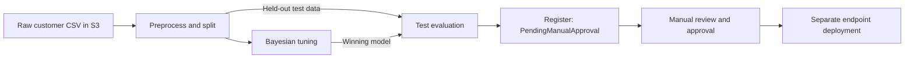

# DriftWatch

DriftWatch trains, evaluates, registers, and serves an XGBoost classifier for IBM Telco Customer Churn data. It combines standalone Python scripts with AWS SageMaker SDK v3 notebooks, carrying the fitted preprocessing state and validation-selected decision threshold from training into inference.

The managed pipeline performs Bayesian hyperparameter tuning, evaluates the winning model on a held-out test set, and registers it as `PendingManualApproval`. A separate deployment notebook creates a real-time endpoint from an explicitly approved model package.

## Workflow



- **Consistent preprocessing:** learn imputation, category vocabularies, reference levels, feature order, and scaling from training data only.
- **Validation-based selection:** use validation `aucpr` for tuning and early stopping, then select a classification threshold by validation F1.
- **Portable model artifacts:** bundle preprocessing code and state with the model, recording SHA-256 hashes in training metadata.
- **Shared inference:** use the same prediction functions for local JSON/CSV input, notebook previews, and SageMaker hosting.
- **Reviewable evaluation:** write machine-readable metrics and a Markdown model card before registration.

The pipeline has no metric threshold gate: successful evaluation allows registration for manual review. It prepares a training-feature baseline, but does not configure scheduled drift monitoring.

## Repository guide

| Path | Purpose |
| --- | --- |
| [Pipeline.ipynb](Pipeline.ipynb) | SageMaker preprocessing, Bayesian tuning, test evaluation, and model registration. |
| [Deployment.ipynb](Deployment.ipynb) | Deploy an approved registry version, check readiness, smoke-test inference, and optionally clean up hosting resources. |
| [steps/preprocess/preprocess.py](steps/preprocess/preprocess.py) | Production data cleaning, splitting, transformation, and preprocessing-state export. |
| [steps/train/train.py](steps/train/train.py) | XGBoost training, early stopping, threshold selection, and artifact creation. |
| [steps/train/preprocessing_artifacts.py](steps/train/preprocessing_artifacts.py) | Validate, hash, and copy preprocessing artifacts into the model directory. |
| [steps/train/requirements.txt](steps/train/requirements.txt) | XGBoost dependency installed by the SageMaker training container. |
| [steps/evaluate/evaluate.py](steps/evaluate/evaluate.py) | Held-out evaluation and report generation from a model directory or archive. |
| [steps/inference/inference.py](steps/inference/inference.py) | Verified artifact loading, prediction API, CLI, and SageMaker serving hooks. |
| [tests/test_serving.py](tests/test_serving.py) | Synthetic inference contract tests using a fake booster. |
| [getbucket.py](getbucket.py) | Download the configured S3 bucket into a local mirror. |
| [AGENTS.md](AGENTS.md) | Repository contracts and contributor instructions. |

The notebooks alongside the step scripts provide exploration and local previews. The preprocessing notebook differs from the production script in encoding order and output layout; use `preprocess.py` as the job contract.

## Prerequisites

Run commands and notebooks from the repository root. Choose an environment with the dependencies needed for your workflow:

| Workflow | Dependencies |
| --- | --- |
| Local preprocessing and synthetic tests | pandas, NumPy, scikit-learn |
| Local training, evaluation, and inference | pandas, NumPy, scikit-learn, XGBoost |
| S3 reads and artifact downloads | boto3, AWS credentials, and access to the relevant objects |
| SageMaker orchestration and deployment | SageMaker Python SDK v3 and boto3, with AWS permissions and an execution role |
| Notebook previews | A Jupyter environment; previews also use IPython |

There is no repository-wide dependency manifest or locked local environment. `steps/train/requirements.txt` pins **XGBoost 1.7.6** for the managed training container; it is not a complete local installation manifest. The notebooks use SDK v3 namespaces such as `sagemaker.core`, `sagemaker.train`, and `sagemaker.mlops`.

AWS workflows require access to the configured S3 locations, SageMaker jobs and registry resources, and permission to pass the execution role. Hosting also requires access to the registered image, model artifacts, inference source, and logs. Review the account-specific settings in both notebooks before running them.

## Local workflow

These commands run the production scripts locally. Preprocessing still reads its raw input from S3; training, evaluation, and inference can then use local files without AWS calls. Replace the bucket and region with your configuration.

### 1. Preprocess the dataset

```bash
python steps/preprocess/preprocess.py \
  --input_s3_uri s3://YOUR_BUCKET/data/raw/telco_churn.csv \
  --region eu-west-1 \
  --output_dir data/processed
```

The script accepts the IBM column aliases defined in `COLUMN_MAPPING`, removes identifier and leakage columns, and normalizes `Churn` labels from `Yes`/`No` or `0`/`1`. It creates stratified **70% training / 15% validation / 15% test** splits with seed **42**.

```text
data/processed/
├── train/train.csv
├── validate/validation.csv
├── test/test.csv
├── baseline/baseline.csv
└── preprocessing/
    ├── preprocessing.json
    └── preprocessing.py
```

The three labeled CSVs have `Churn` in column zero followed by numeric features, without headers or an index. `baseline.csv` contains training features with headers and no label. The `validation` SageMaker channel/output intentionally maps to the `validate` directory.

### 2. Train a model

```bash
python steps/train/train.py \
  --train-path data/processed/train/train.csv \
  --validation-path data/processed/validate/validation.csv \
  --preprocessing-dir data/processed/preprocessing \
  --model-dir artifacts/local-training
```

The explicit paths connect this example to preprocessing's output. Without overrides, training and evaluation look for processed data under `driftwatch-bucket/data/processed/`, while preprocessing defaults to `data/processed/`.

Local training runs one configuration. Defaults include `max_depth=5`, `eta=0.1`, `min_child_weight=1.0`, up to 300 boosting rounds, and early stopping after 15 rounds. Override them with `--max_depth`, `--eta`, `--min_child_weight`, `--num-boost-round`, and `--early-stopping-rounds`.

Training saves:

```text
artifacts/local-training/
├── xgboost-model
├── training_metadata.json
├── preprocessing.json
└── preprocessing.py
```

Metadata records the feature count, training parameters, best iteration, selected threshold, validation metrics, and preprocessing schema version and hashes. Keep these four files together. Adopting a new preprocessing state requires regenerating the datasets and retraining; attaching newly fitted state to an existing model breaks its feature contract.

### 3. Evaluate on the test set

```bash
python steps/evaluate/evaluate.py \
  --test-path data/processed/test/test.csv \
  --model-dir artifacts/local-training \
  --output-dir artifacts/local-evaluation
```

Evaluation writes `evaluation.json` and `model_card.md`, reporting XGBoost `aucpr`, F1, precision, recall, and the confusion matrix. It uses the saved best iteration and validation-selected threshold. Keep the test set exclusively for this final evaluation.

`--model-dir` also accepts a model tar archive or a directory containing one archive. Supply an explicit `--output-dir` when evaluating an archive. Legacy artifacts with the required model and training metadata remain evaluable, but raw-customer inference requires the bundled preprocessing contract.

### 4. Predict raw customers

Save a raw customer object as `artifacts/customer.json`, using the exact feature names, representations, and categorical values expected by your model. For example, the IBM-style payload used by the deployment notebook is:

```json
{
  "Gender": "Male",
  "Senior Citizen": "Yes",
  "Partner": "Yes",
  "Dependents": "No",
  "Tenure Months": 1,
  "Phone Service": "No",
  "Multiple Lines": "No phone service",
  "Internet Service": "DSL",
  "Online Security": "No",
  "Online Backup": "Yes",
  "Device Protection": "No",
  "Tech Support": "No",
  "Streaming TV": "No",
  "Streaming Movies": "No",
  "Contract": "Month-to-month",
  "Paperless Billing": "Yes",
  "Payment Method": "Electronic check",
  "Monthly Charges": 29.85,
  "Total Charges": 29.85
}
```

The model's `preprocessing.json` defines its required features and categories. Column names are case-sensitive except for explicitly configured aliases; for example, `Gender` and `gender` are not automatically interchangeable. Missing required features, missing or unseen categorical values, and invalid numeric values are rejected.

```bash
python steps/inference/inference.py \
  --model-dir artifacts/local-training \
  --input artifacts/customer.json \
  --output artifacts/predictions.json
```

Use a JSON list of objects for a batch, or a CSV with raw feature headers. Omit `--output` to print JSON to standard output. Input format is inferred from `.json` or `.csv`, or set with `--input-format`.

Responses contain a `predictions` list with one `churn_probability` and binary `churn_prediction` per input row, preserving row order. A prediction is `1` when its probability is greater than or equal to the model's saved threshold.

For Python callers:

```python
import json
from pathlib import Path
from steps.inference.inference import load_inference_bundle, predict_churn

bundle = load_inference_bundle("artifacts/local-training")
customer = json.loads(Path("artifacts/customer.json").read_text())
predictions = predict_churn(customer, bundle)
```

`predict_churn()` also accepts a pandas DataFrame. Loading a local bundle verifies the preprocessing hashes, schema, feature count, model objective, and tree range. Imports and local bundle prediction do not contact AWS.

To download artifacts from S3 instead, omit `--model-dir` and set all three artifact locations:

```bash
python steps/inference/inference.py \
  --model-s3-uri s3://YOUR_BUCKET/models/YOUR_TRAINING_JOB/output/model.tar.gz \
  --preprocessing-json-s3-uri s3://YOUR_BUCKET/MATCHING_PREPROCESSING/preprocessing.json \
  --preprocessing-py-s3-uri s3://YOUR_BUCKET/MATCHING_PREPROCESSING/preprocessing.py \
  --input artifacts/customer.json \
  --cache-dir artifacts/inference
```

The download path fetches the model archive and both separate preprocessing files. They must match the preprocessing bundled with that model and its recorded hashes. The script's default S3 model URI points to a specific historical training job; supply your own locations for another run. Downloaded bundles are retained under the cache directory for later use with `--model-dir`.

## SageMaker pipeline

Open [Pipeline.ipynb](Pipeline.ipynb) and review the initialization and parameter cells before execution:

| Setting | Current default or behavior |
| --- | --- |
| Pipeline name | `DriftWatchPipeline` |
| Execution role | Account-specific ARN configured in initialization |
| Domain lookup | Reads `DOMAIN_NAME` from the environment; helper region defaults to `eu-west-1` |
| `RawDataS3Uri` | `s3://driftwatch-bucket/data/raw/telco_churn.csv` |
| `ProcessedDataS3Uri` | `s3://driftwatch-bucket/data/processed` |
| `ProcessedModelS3Uri` | `s3://driftwatch-bucket/models` |
| `ModelPackageGroupName` | `DriftWatchChurn` |

The session region follows the AWS configuration; keep it consistent with the domain lookup and resource locations. `DOMAIN_NAME` should resolve to the domain ARN used in the pipeline tag. Setting the variable in the environment makes it available to the notebook; the notebook does not load a `.env` file itself.

The managed steps use these resources:

| Stage | Container | Compute |
| --- | --- | --- |
| Preprocessing | scikit-learn `1.2-1` | One `ml.t3.medium` |
| Each training trial | scikit-learn `1.2-1`, installing XGBoost 1.7.6 | One `ml.m5.large` |
| Evaluation | XGBoost `1.7-1` | One `ml.t3.medium` |
| Registered inference image | XGBoost `1.7-1` | Hosting chosen separately |

Training uses a framework container so SageMaker accepts the custom `validation:best_aucpr` tuning objective. Its requirements installation needs package-index access. Processing jobs do not install the training requirements.

Bayesian tuning runs **10 trials**, with **one concurrent trial** and seed **42**, maximizing `validation:best_aucpr`:

| Hyperparameter | Range | Scale |
| --- | --- | --- |
| `max_depth` | 3–8 | Linear, integer |
| `eta` | 0.05–0.20 | Logarithmic |
| `min_child_weight` | 1–10 | Logarithmic |

The tuner reads `HPO_METRIC best_aucpr=...` from training logs. The highest-ranked trial supplies the model archive for evaluation and registration. Evaluation reports go to `<ProcessedModelS3Uri>/evaluation/<PIPELINE_EXECUTION_ID>/`; training archives go under `<ProcessedModelS3Uri>/artifacts/`.

The submission cell creates the default package group if absent and calls `pipeline.upsert()`. A runtime `ModelPackageGroupName` override must reference a group that already exists in the pipeline region. The final cell calls `pipeline.start()`, waits, and reports failure details if execution does not succeed.

Registration attaches `evaluation.json` and a draft package model card linking the winning training job. `ModelBuilder` packages the standalone inference entry script separately from the winning model archive. Registered request types are `application/json` and `text/csv`; responses are `application/json`.

Notebook initialization contacts AWS, and pipeline construction can package or upload source. Submission and execution change cloud resources and launch billable jobs.

## Approval and real-time deployment

1. Review the winning model's evaluation reports and registry package, then manually approve the selected version.
2. Open [Deployment.ipynb](Deployment.ipynb) and set `MODEL_PACKAGE_ARN` to that explicit versioned ARN in the same AWS account and region.
3. Review `AWS_REGION`, `EXECUTION_ROLE_ARN`, `ENDPOINT_NAME`, `INSTANCE_TYPE`, and `INSTANCE_COUNT`. The current hosting configuration uses one `ml.c6i.large`; a blank endpoint name generates a unique name.
4. Run the validation, creation, readiness, and raw-customer smoke-test cells. The notebook requires `ModelApprovalStatus='Approved'` and refuses existing model, endpoint-configuration, or endpoint names.
5. Use the optional cleanup cell when finished. It validates ownership tags and resource relationships before deleting the endpoint, endpoint configuration, and hosting model. Registry versions and S3 artifacts are preserved.

**Review `DELETE_ENDPOINT_NAME` before running all cells.** Cleanup runs only when it matches the chosen endpoint name, and the saved notebook currently contains a previous endpoint name in that field. Clear it when retaining a deployment; set it to the exact target name only when intentionally cleaning up.

An endpoint continues to incur hosting charges while idle. A deployment wait timeout leaves resources in place; rerun the readiness check or inspect the endpoint and CloudWatch logs.

## Metrics and reproducibility

- The optimization metric is **XGBoost `aucpr`**, stored as `validation_metrics.aucpr` in training metadata and `classification_metrics.aucpr.value` in evaluation JSON. Scikit-learn average precision is a different metric; historical notebook output labeled `pr_auc` should not be interpreted as a new XGBoost `aucpr` measurement.
- Training, evaluation, and inference use trees through `best_iteration + 1`. The saved model can contain additional rounds from early stopping.
- Threshold selection maximizes validation F1 over thresholds from 0.00 through 0.99 in steps of 0.01. The test set does not select the threshold or hyperparameters.
- Split and training seeds are 42. Recorded artifacts and metadata describe a run; saved notebook outputs are historical results, not guarantees for a new run.

## Development checks

Run the synthetic contract tests with pandas, NumPy, and scikit-learn available:

```bash
python -m unittest discover -s tests -v
```

The tests use temporary synthetic preprocessing artifacts and a fake booster. They cover shared JSON/CSV predictions, best-iteration and threshold behavior, invalid input, metadata validation, and artifact integrity without AWS calls or model training. They do not establish real-container compatibility or model quality.

For a source-only syntax check without importing project code or executing notebooks:

```bash
python - <<'PY'
import ast
import json
from pathlib import Path

for path in [Path("getbucket.py"), *Path("steps").glob("*/*.py")]:
    ast.parse(path.read_text(), filename=str(path))
for path in [*Path(".").glob("*.ipynb"), *Path("steps").glob("*/*.ipynb")]:
    notebook = json.loads(path.read_text())
    for index, cell in enumerate(notebook["cells"]):
        if cell["cell_type"] == "code":
            ast.parse("".join(cell["source"]), filename=f"{path}:cell{index}")
print("Python and notebook syntax OK")
PY

git diff --check
```

There is no configured CI workflow or repository-wide lint/type-check command. Preserve notebook outputs and execution counts when editing source cells, and keep notebook logic consistent with the corresponding scripts where they share behavior.

Generated datasets, model artifacts, bucket mirrors, caches, virtual environments, and `.env` files are excluded by `.gitignore`. `getbucket.py` is an optional AWS operation that downloads the entire configured bucket to its configured local path; it is not a setup check.
